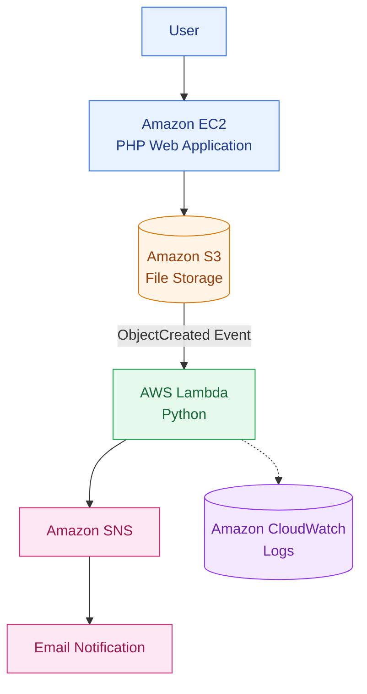
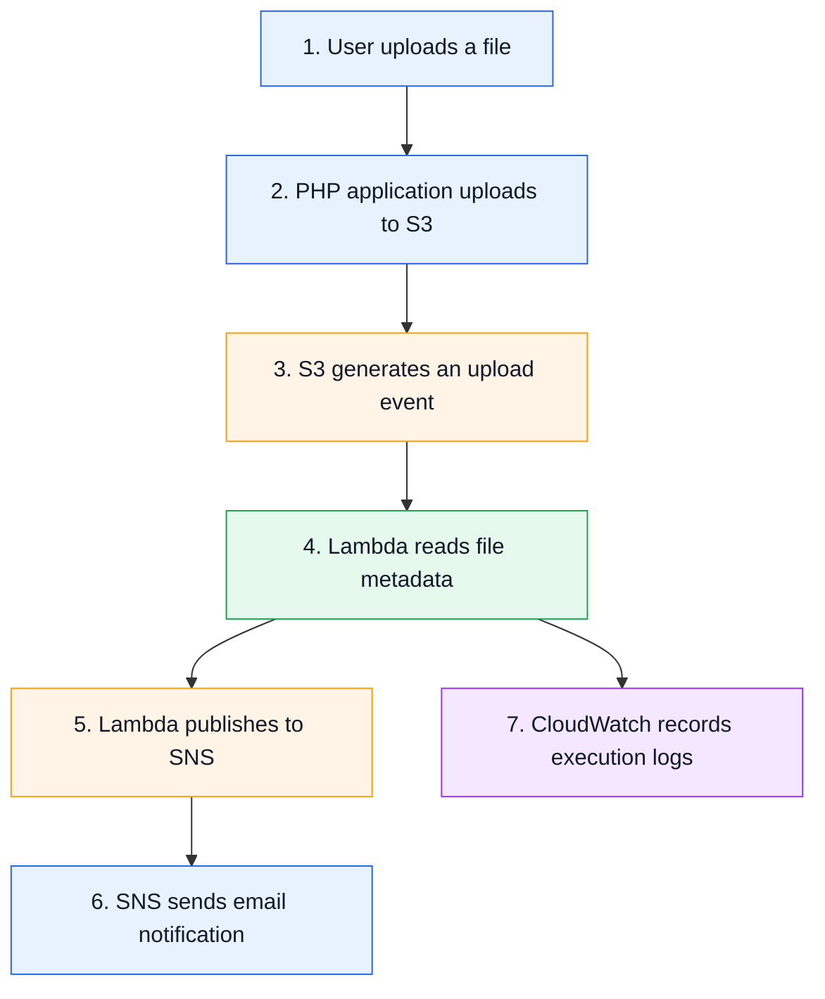

<h1 align="center">AWS Event-Driven File Upload Notification System</h1>

<p align="center">
  <b>An automated, event-driven file upload system that sends email notifications using AWS serverless services.</b>
</p>

<p align="center">
  
  
  
  
</p>

---

## 🚀 Project Overview

This project demonstrates how AWS services can be integrated to build an automated file upload and email notification system.

Users upload files through a PHP web application hosted on Amazon EC2. Amazon S3 stores the uploaded files and automatically triggers an AWS Lambda function. Lambda extracts the file details and publishes a notification to Amazon SNS, which sends an email to subscribed users.

The entire process runs automatically without requiring manual monitoring.

## 🏗️ Architecture




## 🛠️ AWS Services

<p align="center">
  
</p>

<p align="center">
  
  
  
</p>

<p align="center">
  
  
  
</p>

## 💻 Technology Stack

| Category | Technologies |
|---|---|
| Cloud Platform | Amazon Web Services |
| Web Application | PHP, HTML |
| Serverless Computing | AWS Lambda, Python 3.12 |
| File Storage | Amazon S3 |
| Messaging | Amazon SNS |
| Web Server | Apache HTTP Server |
| Operating System | Amazon Linux 2023 |
| SDK & Package Manager | AWS SDK for PHP, Composer |

## 🔄 Workflow



## 📁 Project Structure

```text
AWS-Event-Driven-File-Upload-Notification-System/
│
├── index.html
├── s3upload.php
├── lambda_function.py
├── README.md
├── Task.pdf
└── AWS Event-Driven File Upload Notification System.pdf
```

## 🔐 IAM Security

The project uses IAM roles to grant AWS services the permissions they need, without storing AWS access keys in the application.

| IAM Role | Permissions |
|---|---|
| EC2 Instance Role | `s3:PutObject` |
| Lambda Execution Role | `s3:GetObject`, `sns:Publish` |

## ✨ Key Features

- Automated file upload and storage using Amazon S3.
- Event-driven processing with AWS Lambda.
- Automatic email notifications through Amazon SNS.
- Secure IAM role-based authentication.
- CloudWatch logging for monitoring and troubleshooting.
- Serverless processing without manually managing compute infrastructure for Lambda.

## 📄 Documentation

The complete implementation guide, including commands, configurations, screenshots, and deployment steps, is available below.

📘 [View the Complete Deployment Guide](./AWS%20Event-Driven%20File%20Upload%20Notification%20System.pdf)

## 🎯 Skills Demonstrated

<p align="center">
  
</p>

<p align="center">
  
  
  
</p>

## ✅ Project Outcome

Successfully implemented an automated file upload notification system using AWS.

Whenever a user uploads a file through the PHP application, the system automatically stores it in S3, processes the upload event with Lambda, and sends an email notification through SNS.

This project demonstrates practical experience in event-driven architecture, serverless computing, cloud integration, and automated notification workflows.

## 📚 Learning Outcomes

- Building event-driven cloud applications.
- Configuring Amazon S3 event notifications.
- Integrating AWS Lambda with S3 and SNS.
- Managing IAM roles and permissions.
- Monitoring serverless applications with CloudWatch.
- Integrating PHP applications with AWS SDK.
- Building automated workflows using AWS services.

---

<p align="center">
  <b>Built as a hands-on AWS and DevOps learning project.</b>
</p>
